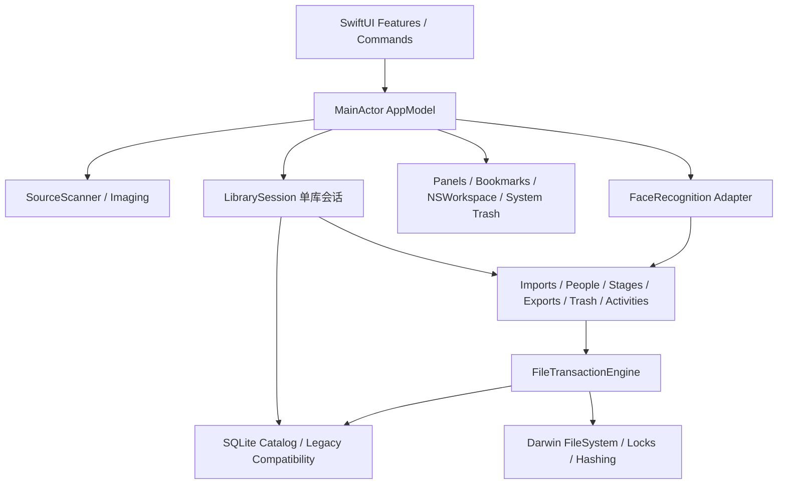

# LUMIX macOS 原生版架构设计

日期：2026-11-03。本文为设计基线；当前实现与实测范围见 `NATIVE_SOURCE_NAVIGATION_VALIDATION.md`。

## 1. 输入与工作区边界

用户要求：Swift 主语言、SwiftUI 主界面、必要时窄范围 AppKit、Xcode 工程构建调试、无 Python 运行时，保留核心业务和数据兼容，按 macOS 习惯重设计。先设计，再按阶段开发。

2026-11-04 调整：用户允许 Python、Java 等辅助实现，主要诉求为 SwiftUI 的原生动画与液态玻璃，优先简单、实用的小步开发。现有功能继续复用 Swift 实现；只有确实能减少工作量时才引入其他运行时。原 Windows 项目与来源只读、arm64 构建边界不变。

2026-11-04 晚最新范围：用户明确暂不需要与 Windows 通用。当前按 macOS 独立应用推进；取消本轮数据互通、旧库转换、双向写回和往返兼容验收。下面已有只读兼容设计作为历史参考保留，不继续扩展，不作为完整 macOS 版的交付门槛。原 Windows 源码仍只读。

参考项目：`Reference/Windows/`，GitHub main 提交 `0516266f0b20b91188937e79ee1ae0b9116853dc`。这是独立参考克隆，不修改其应用、测试、构建或资源文件，不向远端推送。应用与构建源码逐文件摘要见 `source-baseline.json`。已阅读全部72个应用/构建源码文件，并核对全部 Python 测试及状态、任务 CJS 测试；其他浏览器回归尚未逐份复核，也未运行 Windows 测试。

用户提供的 `/Users/edison/Downloads/MACOS_MIGRATION.md` 已完整阅读。它记录基线 `070f16e…`，与当前远端不同；GitHub compare 返回404，不能声称两个提交内容完全一致。文档提到的旧设计草案没有随当前仓库提供。迁移文档作为业务分析材料，其中“本轮只新增本文”等历史范围不覆盖用户本次开发要求。实际代码作为可执行业务基线，文档建议作为待验证设计。

所有新实现放入独立 `macos/`；本文及计划在根目录 `docs/`。不把 Windows 源码复制成 Swift 占位文件；逐项实现与验收。

## 2. 目标与初始技术选择

| 项目 | 初始选择 | 验证边界 |
|---|---|---|
| 本机环境 | Apple M2 / arm64，macOS 27.2 (26B123)，Xcode 27.2 (27B52)，macOS SDK 27.2 | 已用系统命令核实；不代表其他系统已测试 |
| 最低系统 | 暂定 macOS 14.0，Swift 6 语言模式 | P0/P1 编译验证；低版本实机支持需另验 |
| 架构 | 仅 Apple Silicon / arm64（用户已明确收窄范围） | Debug/Release 固定 arm64；不安排 Intel/Universal 构建与验收 |
| 工程 | 提交可直接打开的 `.xcodeproj` + shared scheme，核心为本地 Swift Package | Xcode app/core test/UI test targets；不依赖工程生成工具运行 |
| UI | SwiftUI WindowGroup、NavigationSplitView、Inspector、Settings、Commands | 单主工作流会话，辅助预览/管理窗口；首版不开放同库多窗口写入 |
| 持久化 | 系统 SQLite3，轻量类型化封装；保留旧10表和 `.片集` 目录 | 不以 SwiftData 替换旧库 |
| 图像 | ImageIO / CoreGraphics；系统 RAW 能力先验证 | 真 RW2 不支持时评估原生 LibRaw；失败仍保留可导入原文件 |
| 人脸 | YuNet/SFace 同模型的 C++/Objective-C++ 薄适配 | Swift 控制业务；C++ 只负责推理/对齐，模型和依赖显式打包 |
| 初期运行 | 本机开发签名；无账户、云或网络功能 | Developer ID/公证/App Store 尚未选择或发布 |

初期本机构建不启用 App Sandbox；文件授权仍只来自用户选择，并在平台层预留书签生命周期。若后续确定沙箱发行，在接写操作前验证只读来源/可写库的 security-scoped bookmark 和外部编辑器授权。证书、公证、沙箱与上架是后续发行决策。

## 3. 依赖与模块



拟建结构：

```text
macos/
  LaundryPhotoManager.xcodeproj/
  App/                  # App、场景、Commands、AppModel 和会话装配
  Features/
    Sources/ Culling/ Library/ Activities/ People/
    Viewer/ Inspector/ Exports/ Trash/ Settings/ SharedUI/
  Packages/PhotoWorkflowCore/
    Sources/PhotoWorkflowCore/
      Domain/ Queries/ Persistence/ Compatibility/
      LibrarySession/ FileTransactions/ Services/
    Tests/PhotoWorkflowCoreTests/Fixtures/
  Platform/             # AppKit、书签、Finder/编辑器、系统废纸篓
  Imaging/              # ImageIO、RAW、EXIF、缩略图和缓存
  FaceRecognition/      # 原生推理薄桥接与模型版本
  Resources/            # 图标、模型清单、实际依赖许可证
  Tests/ UITests/
script/build_and_run.sh
.codex/environments/environment.toml
```

核心不依赖 SwiftUI/AppKit；首个增量包含 Foundation/CryptoKit/Darwin 与可测试的 ImageIO/CoreGraphics 读取服务，后续接 SQLite3。值模型实现 Sendable，采用类型化 ID 防止混用照片、资产、人物和扫描身份。图像层返回可发送数据/受控图像结果，由界面创建呈现对象。View 不直接执行 SQL、移动文件或更新数据库路径。

库会话统一拥有连接、路径解析、锁、事务日志与恢复状态；服务使用同一会话，不各自创建库或日志。数据库封装暴露参数化查询和事务，错误保留 SQLite code 与具体路径。业务结果区分成功、部分完成、取消和需要恢复，不能压成 Bool。

## 4. 状态、并发与退出

- `@MainActor @Observable AppModel` 是主窗口会话所有者；来源、扫描、库、活动、人物、筛选、两个照片选择集合、按 scope 的文件夹选择及历史只保留一份。弹窗表单和预览手势为局部状态。
- `LibrarySession` 管理读写租约和串行写闸门。actor 隔离本身不能保证跨 await 的事务排他；整项文件事务必须持有不可重入写租约，后来的写请求排队。
- 扫描、流式摘要、图像解码与推理不在 MainActor 执行。先维持一个业务写任务、至多两个图像读取任务，测量后调整。
- `AsyncStream<TaskProgress>` 发布阶段、done/total、路径与错误。取消仅在安全边界响应：扫描可中断，写操作完成当前照片组的提交/回滚后再停止。
- 异步结果携带 librarySessionID、scanID、photoID 和 revision；切库/切图/重扫后旧结果丢弃。预览打开时冻结序列，“只看已选”在关闭后更新过滤。
- 退出先禁止新写任务、请求协作取消、等待事务和读取租约结束，再关闭数据库/书签并释放锁；慢 IO 给明确等待状态，不强杀写线程。

## 5. 不变的业务契约

1. 来源永远只读：扫描、预览、摘要不写来源；导入只复制。按条隔离不可读文件/目录，报告系统错误与路径。
2. JPEG/RAW/XMP 按同目录 stem 或明确兄弟格式目录配对；歧义不合并。来源扫描格式沿用旧扩展名集合，不把 PNG/HEIC 悄悄纳入来源。
3. 导入按活动与原始成员摘要去重；先 JPEG 后 RAW 补齐不改 photoID、人物、人工分类、edited、主成片；本机已编辑 JPEG 字节保持。
4. `edited` 和 `primary_export_id` 独立；成片与待修/已修不建互斥枚举。打开 Photoshop 只记录请求，不自动标已修。
5. 人物归属限同活动；固定“合照/待分类”不可删改；删普通分类移回待分类，保留成片、缺失与回收站关联。
6. 成片支持多个版本、主封面、JPEG 直接复制标成片；RAW-only 拒绝。解除关联移动到“取消关联保留”，不删原片、不重置已修。
7. 照片组先入应用回收站；永久删除与整库系统回收分别实现。活动全部入站成功才隐藏，恢复任意一张恢复活动。
8. 日期保存无时区本地拍摄时间，不强转 UTC；未知日期保持未知。排序沿用 captured_at、rowid。
9. 撤销归档仅在成功 move 且当前状态匹配时执行新事务；不能用浏览返回代替，也不扩大为任意操作撤销。
10. 原始导入摘要、当前字节摘要、文件身份各自有用途，不能合并为单一 hash。

43个原桥接方法映射为类型化业务接口；不保留 pywebview 界面。用户放宽运行时限制后，后续可由 Swift 调用隔离的本机 Python 业务服务，复用既有规则；界面、动画、文件选择和系统集成仍由 SwiftUI/AppKit 提供。旧库只读入口不交给会建表或恢复日志的原版 Library 构造器；功能覆盖由实施计划追踪。

## 6. 文件事务引擎

初始状态机：`planned → running → committed`；失败进入 rollback，不能安全恢复则 needsAttention 并阻止普通写操作。原有 operation payload 解码器与 Mac 新操作格式分离，版本明确，不在读取时执行历史 SQL。

执行顺序：写入可恢复计划 → 验证来源摘要与身份 → 排他创建 staging → 流式复制并同步/校验 → 持久化 staging 身份 → 无覆盖发布 → 校验目标 → 单次 SQLite 事务更新业务与日志 → 提交后清理已知空目录。

移动、staging 发布、回滚都统一调用 Darwin 排他重命名 primitive（`renameatx_np/renamex_np + RENAME_EXCL`，以 SDK 与卷实测为准）。目标存在或卷不支持时返回错误；不能降级普通 rename 覆盖。跨卷 EXDEV 明确失败，未来如支持 copy+delete 必须有独立日志协议。

路径使用根目录文件描述符与逐组件检查，拒绝越界、符号链接/未知链接目标；尽量通过持有的描述符完成读取与身份核验。文件名比较需覆盖大小写卷、NFC/NFD、Python casefold 差异。既保留 Windows 名称限制，又以目标卷实际冲突为最终依据。

回滚只处理可证明归属的目标；同字节外来替换文件也保留。永久删除的 check/unlink 仍有外部竞争，actor 不提供外部互斥保证；P3须先验证受控隔离、身份复验和删除协议，再接 P6。文件 fsync、目录持久化和 F_FULLFSYNC 的保证分开记录；未做断电测试不声称断电原子性。

整库回收经完整路径/容量/数量预检、精确库名确认、token 与目录/数据库身份复验后使用系统 Trash；失败保持库与入口，禁止降级永久删除。空目录清理只针对已知托管候选，不递归删除外来文件。

## 7. 旧库兼容策略（后续范围暂缓）

区分四个层次：读取语义兼容、转换副本兼容、Mac 原生库、双端往返兼容。首个只读版本只承诺第一层；不隐含允许转换或写回。

只读打开不建表、不切 WAL、不回填、不自动恢复，也不新建旧库 lock 文件。关闭 Windows 应用并取得可用锁；旧库缺少锁文件或活跃 WAL 无法只读访问时报告限制。不能以 `immutable=1` 绕过活跃 WAL；需要快照时由明确的一致备份流程生成隔离副本。

当前 P2 采用稳定文件复制：只读描述符读取主数据库与 WAL，复核文件身份、mtime 与完整字节；只有两次一致才在临时目录打开 SQLite，并开启 query_only、关闭 trusted_schema。源 SHM 不读取或创建，非空回滚日志直接拒绝。WAL 中未 checkpoint 的记录会在临时副本中读取，不使用 immutable。每个数据库/WAL 文件暂限 512 MB；这是只读浏览快照，不是整库备份或跨进程写锁，仍要求先关闭其他使用该库的程序。嵌套历史 payload 仅保留和诊断，不改路径、不执行 SQL。

保留全部10表、ID、哈希、嵌入向量、人工标记、日期、成片及缺失关系。兼容层解释：assets/detached 路径、trash 原位置、operation changes/src/dst/temp/sql 参数/cleanup、purges 路径和身份。未知 payload 版本保留原文并限制写入。

Windows drive/UNC 路径按 Windows 语法解析，不能直接交给 Mac URL。用户明确选择旧根与新根后生成映射预案；只改结构化受管路径，不对整个 JSON/SQL 做字符串替换，不凭同名猜测。外部来源历史不自动映射为可写托管文件。

存在 pending operation、purge 或归属不明 partial 时保持只读，不先执行旧平台恢复。历史 `[st_dev,st_ino]` 不可迁移，不能用 SHA 一致自动换发历史回收站删除凭据。

Windows0.12.1不理解Mac绝对路径/新日志。因此本次不修改它，也不宣称直接往返。P2可先只读展示；启用转换副本必须明确转换边界。真正双向写回需要配套 Windows 协议，属于另行明确的 Windows 工作范围。未作此决策不阻碍只读开发。

SQLite 数据库一致快照使用 Online Backup API；它不替代整个照片目录的备份，后者仍需会话锁与文件清单验证。[SQLite Backup API](https://sqlite.org/backup.html)

## 8. macOS 交互

SwiftUI 原生侧栏单击导航、工具栏主命令、可隐藏检查器、独立 Settings（Cmd+,）、菜单和快捷键共用命令路由。保持深色摄影工作区与原品牌层次，采用系统字体/SF Symbols，去除 Windows 自绘窗口框。材质与减少透明度/高对比响应系统；先用系统 material，后续再决定是否增加版本门控 Liquid Glass。

原生 NavigationSplitView 负责导航列与内容列，详情使用 Inspector。[Apple NavigationSplitView](https://developer.apple.com/documentation/swiftui/navigationsplitview)

照片网格优先做局部 NSCollectionView 原型，SwiftUI 负责外层界面；原因是当前单击叠加选择、双击恢复首次单击前选择、右键保持多选、框选/边缘滚动不能直接交给默认系统 selection。若纯 SwiftUI 原型通过同等测试，可减少桥接。

预览画布必要时用 NSScrollView/NSView 局部桥接处理 precise wheel、鼠标锚点、拖动和 backing scale；SwiftUI 负责工具栏与照片序列。锚点误差按显示像素测量，目标≤2像素；缩放2%–1600%、每张切图fit、空格只切选择、不拦截按钮原生激活。

Cmd+A只覆盖当前可见项目，保留隐藏范围选择；来源跨目录选择保留。主区文件夹选择独立于照片；右键侧栏只针对单条。返回采用 Cmd+[，与撤销归档分开。网格方向键/Enter、回收站Cmd+A若补充则单列新增交互验收。

弹窗保留失败表单和选片上下文；后台任务给取消与部分完成明细，不把全部导航永久锁为模态。所有主要命令具可发现按钮或菜单、焦点和 VoiceOver 标签。

## 9. 验证和交付

领域规则用 Swift Testing/XCTest；真实目录夹具验证扫描、摘要、事务故障与重启；XCUITest 验证真实原生 UI。Windows 测试是规则参考，不作为 Mac 通过证据。

每阶段记录代码变化、测试命令/结果、支持环境、未完成项和下一阶段。构建统一经 Xcode shared scheme；调试配置 LLDB；项目提供 build_and_run.sh 和 Codex Run。未实现功能不显示可用假按钮，不用示例缩略图冒充真实读取。

首个开发交付为P0契约与P1只读来源纵向流程；全部功能替代完成以 `IMPLEMENTATION_PLAN.md` 的P0–P9验收为准。
