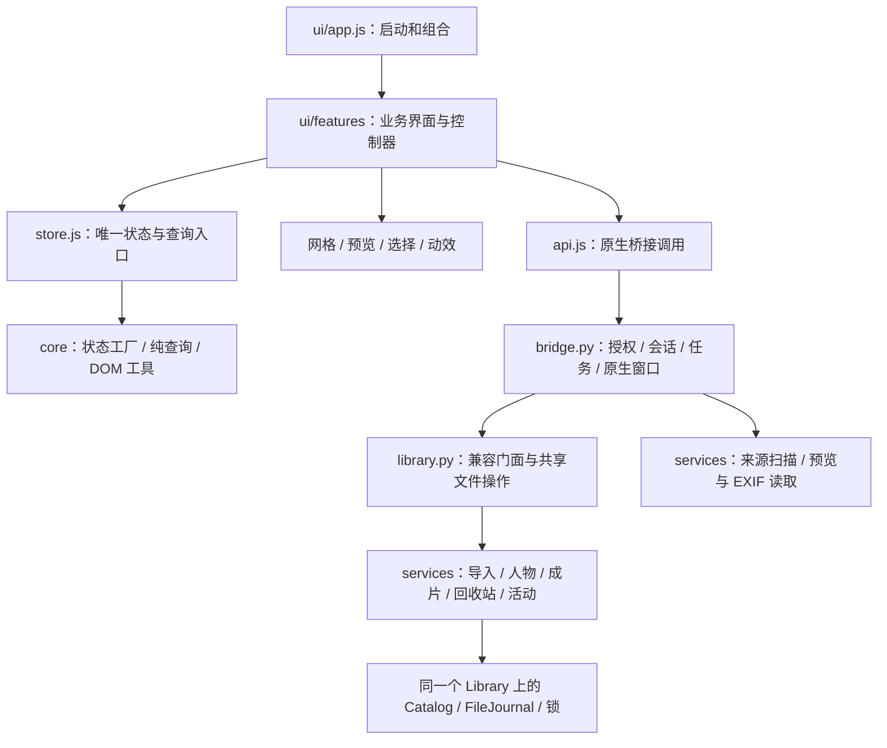

# LUMIX 洗衣机管理器 · 代码地图

本轮将 0.12 整理为功能模块。继续使用 Python + 原生 JavaScript + pywebview/WebView2；外观、操作和照片库格式沿用 0.12。改动某项功能时，从下面对应行开始，无须先阅读整个软件。

## 改什么，看哪里

所有路径均相对于项目根目录 `LumixGpt`。

| 要修改的功能 | 界面入口 | Python 业务 / 验证 |
|---|---|---|
| SD/文件夹读取、取消、导入后跳转 | `pianji/ui/features/tasks.js` | `services/source.py`、`discovery.py`；`test_discovery.py`、`test_bridge.py`、`task_controller.cjs` |
| 导入活动、导入格式、新建活动 | `ui/features/import-dialogs.js` | `services/imports.py`、`services/activities.py`；`test_services.py`、`test_v04.py` |
| 活动/人物/来源侧栏、面包屑、右键 | `ui/features/sidebar.js` | 活动和人物服务；`ui_v04.cjs`、`ui_v05.cjs` |
| 人物调整、新建、重命名、合并、删除 | `ui/features/people-dialogs.js` | `services/people.py`；`test_v05.py`、`test_v07.py` |
| 人脸识别 | `ui/features/workspace.js` 中识别按钮 | `faces.py`；`test_faces.py` |
| 照片/文件夹网格、缩略图、选中反馈 | `ui/gallery.js`、`ui/choice-list.js` | `previews.py`；`ui_smoke.cjs`、`ui_boundaries.cjs` |
| 缩略图滑杆、尺寸更新与文件夹比例 | `ui/thumbnail-size.js`、`ui/gallery.css` | `ui_thumbnail_resize.cjs`（80–720、长名称、SD、帧合并及性能记录） |
| 拖动框选、Shift 多选、键盘选片 | `ui/selection.js` | `ui_smoke.cjs`、`ui_feedback.cjs` |
| 大图预览、滚轮缩放、拖动、空格选片 | `ui/viewer.js` | `services/photo_reads.py`、`previews.py`；`ui_v08.cjs` |
| 右侧详情、EXIF、PS、关联成片 | `ui/features/inspector.js` | `metadata.py`、`photoshop.py`、`services/exports.py`；`test_finished.py`、`ui_v06.cjs` |
| 阶段筛选、工具栏、批量命令 | `ui/features/workspace.js` | `library.py` 的移动/批处理与成片服务；`ui_boundaries.cjs` |
| 回收站、照片/活动删除和恢复 | `ui/features/trash-dialogs.js` | `services/trash.py`、`services/activities.py`、`permanent.py`；`test_v03.py`、`test_v06.py`、`test_v07.py` |
| 创建/切换/删除整个照片库 | `ui/library-manager.js` | `bridge.py` 的库会话、`library_deletion.py`、`cleanup.py`；`test_v07.py` |
| Photoshop 路径、设置弹窗 | `ui/features/settings-dialog.js` | `bridge.py` 的设置、`photoshop.py`；`test_photoshop.py` |
| 日期、人物、格式、只看已选等筛选规则 | `ui/core/queries.js` | `tests/state_modules.cjs`（无 DOM） |
| 弹窗基本结构、确认、错误与焦点 | `ui/core/modal.js` | `ui_v09.cjs`、`ui_v012.cjs` |
| 任务结果与扫描错误文案 | `ui/features/result-dialog.js` | `jobs.py` 的任务快照、`test_jobs.py` |
| 导航滑块与玻璃、人物展开 | `ui/sidebar-motion.js`、`ui/chrome-motion.js` | `ui_v010.cjs`、`ui_v011.cjs` |
| 文件夹进入/返回动画及历史 | `ui/workspace-motion.js`、`ui/navigation.js` | `ui_v012.cjs` |
| 主窗口开合动画 | `window_motion.py`、`app.py` | `test_window_motion.py` |
| 液态玻璃光学 | `ui/glass.js`、`ui/glass-optics.js` | `optics_v09.cjs`、`ui_v09.cjs` |
| 全局布局与材料样式 | `ui/app.css`、`ui/glass.css`、`ui/pearl.css` | 1040×720 / 1440×960 浏览器回归；`pearl.css` 名称保留，实际是深色 |

表格中省略前缀的 Python 文件位于 `pianji/`；`ui/` 也位于该目录。测试全部位于 `tests/`。

## 模块如何连接



- `app.js` 创建控制器并把 `refresh`、`render`、`start` 回调交给需要的模块。业务模块不反向导入 `app.js`。
- `store.js` 是兼容入口，只创建一次应用状态。`core/state.js` 的 `createState()` 和 `core/queries.js` 的 `createQueries(state)` 用于独立验证；业务模块不要另建一份状态。
- `dialogs.js` 只转导出，旧调用保持兼容；新功能直接导入自己的对话框模块。共享弹窗原语放在 `core/modal.js`。
- `tasks.js` 独自持有当前任务 ID 和准备扫描的来源；`inspector.js` 独自持有详情请求版本号。失败/取消后恢复 UI；过期图片请求不能覆盖新照片。
- `Library` 仍持有库根锁、`RLock`、`Catalog`、`FileJournal`、恢复状态及文件目的地/批处理规则。业务服务接收这个已有上下文，不创建第二个 `Library`、连接池或日志。
- `Bridge` 仍拥有原生窗口、来源授权 token、扫描注册表、设置、当前库、任务队列和预览线程池。前端只调用原有公开方法；服务函数不会因此额外暴露给网页。
- `services/source.py` 只读授权来源，完成后才发布扫描；`services/photo_reads.py` 在原读锁内取得路径并读文件。预览缓存合并仍由 `ui/previews.js` / `previews.py` 负责。
- 永久删除、整库删除、空目录清理和文件日志已有各自安全边界，继续在原独立模块中维护。不要为了目录整齐复制或分散这些判断。

## 开发与验证

在本项目根目录运行（Windows 11，Python 3.12 x64）：

```powershell
py -3.12 -m venv .venv
.\.venv\Scripts\python.exe -m pip install -r requirements-dev.txt
.\.venv\Scripts\python.exe packaging/fetch_models.py
.\.venv\Scripts\python.exe run.py
```

下载模型只用于准备源码环境，平时使用应用不联网。本工作区已带入并校验已有模型；Git 不跟踪 ONNX 大文件。

```powershell
.\.venv\Scripts\python.exe -m pytest -q
npm ci
npm test
```

Node 仅用于开发测试，便携应用不需要 Node。浏览器测试使用本机 Microsoft Edge；产物写入项目的 `.superpowers/ui-artifacts`，不依赖旧工作区。`npm test` 依次运行状态、任务、光学和全部 UI 回归，任意失败返回非零状态。

```powershell
.\packaging\build.ps1 -Python .\.venv\Scripts\python.exe
$env:PIANJI_BUNDLE = "$PWD\dist\洗衣机管理器-Windows-0.12.1"
.\.venv\Scripts\python.exe -m pytest -q
```

默认便携包位于 `dist/`，构建临时文件位于 `build/`，可通过 `-OutputsRoot` / `-BuildRoot` 显式指定。新 UI 子目录随整个 `pianji/ui` 递归打包；打包检查会比较全部资源与源码，避免漏模块或混入旧文件。

本次是 0.12 内部结构整理，产品版本维持 0.12；验证包使用 `0.12-modular` 名称以便与旧交付区分。旧工作区、Git 历史和交付文件保留。
